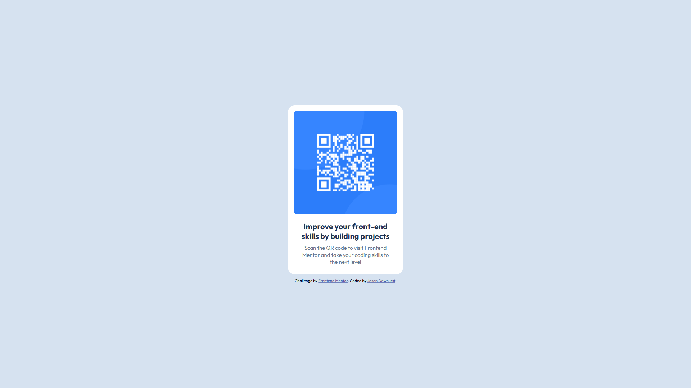

# Frontend Mentor - QR code component solution

This is my solution for the QR code challenge.

## Table of contents

- [Overview](#overview)
  - [Screenshot](#screenshot)
  - [Links](#links)
- [My process](#my-process)
  - [Built with](#built-with)
  - [What I learned](#what-i-learned)
  - [Continued development](#continued-development)
  - [AI Collaboration](#ai-collaboration)
- [Author](#author)

## Overview
### Screenshot

### Links

- Solution URL: [Project Repo](https://github.com/VelzCode/FE-Mentor.qrcode)
- Live Site URL: [Live Page](https://velzcode.github.io/FE-Mentor.qrcode/)

## My process

I built the markup first to create the framework for the design, afterwards I used the files to build a style.css file to provide the style for the project.
I used root variables, universal values and body values, I also used commented sections to seperate code into organised structure.

### Built with

- Semantic HTML5 markup
- CSS custom properties
- Flexbox

### What I learned

Measuring a design from a jpg image: designers work in round numbers so 318 became 320 for the card and 291 became 288 for the image which gave the 16px padding.

Understanding clamp and the calc function to keep the text on same lines when reducing screen width.

### Continued development

Mobile first responsive projects, JavaScript learning with Claude and future challenges.
Learning markdown formats, and writing formatted files.

### AI Collaboration

Briefly used Claude for some Debugging issues using F12, and understanding clamp.

## Author

- Website - [Portfolio](https://velzcode.github.io/Portfolio.Main/)
- Frontend Mentor - [@VelzCode](https://www.frontendmentor.io/profile/VelzCode)